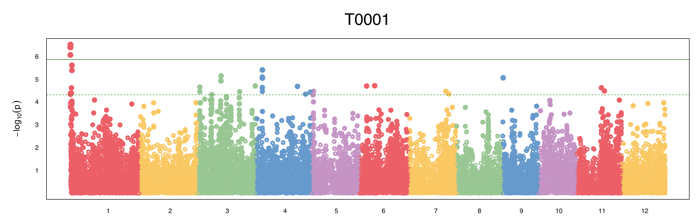
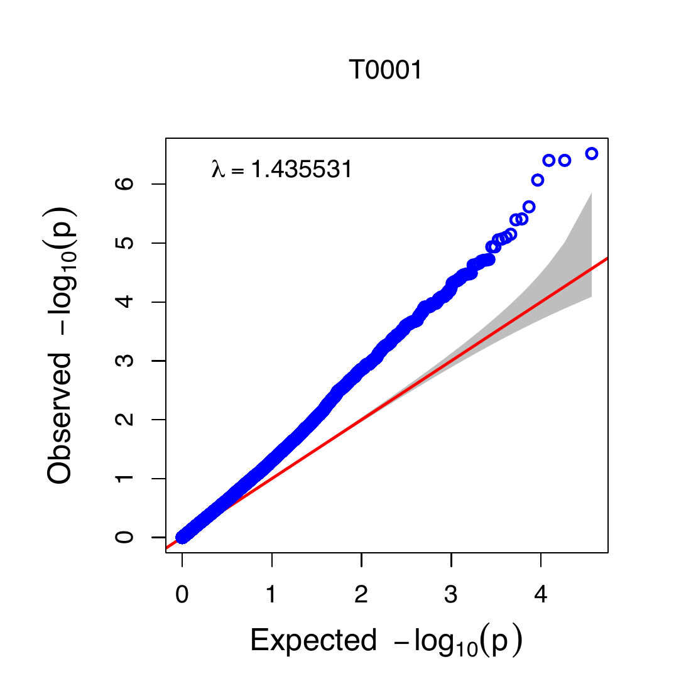

# BLINK-AI

**Genotype merging, format conversion, and large-scale GWAS — guided by your AI agent.**

For Codex, Claude Code, TRAE, and compatible hosts.

[Download the skill](releases/blink-ai-v0.2.7-macos-arm64-windows-x86_64.zip) · [Usage guide](blink-ai/references/usage.md) · [Example data](blink-ai/references/example-data.md)

## Start with a link or ZIP

Give your agent this repository link or the downloaded skill ZIP and ask:

> Read BLINK-AI from the repository link or ZIP I provided. Download or extract the complete skill, read SKILL.md and the full GWAS R template, check the required environment, and use BLINK-AI for my analysis. Install it in this project's skill directory for future sessions.

The agent needs access to local files and command execution, **Python 3.9+**, and **R**. It can prepare the required R packages automatically. Native executables are included for **macOS ARM64** and **Windows x86-64**. Reading the web page alone does not download the analysis tools; ask the agent to retrieve the complete skill.

## Main features

| Feature | What BLINK-AI does |
|---|---|
| **Merge genotype files** | Combine chromosome or numbered chunks after checking sample identity, sample order, and SNP IDs. Merge before fitting one genome-wide model. |
| **Convert formats** | Convert among PLINK binary, VCF, VCF.gz, Numeric, HapMap, and BLINK, preserving supported hard calls and metadata. |
| **Large-scale GWAS** | Run native BLINK or GLM with QC, multiple traits, covariates, sample selection, and configurable model parameters. SNP blocks start at 2,000 and shrink automatically on recoverable block workspace allocation failures. |
| **Plots and reports** | Produce GAPIT Manhattan and QQ plots, Bonferroni/BH-adjusted results, analysis reports, and reproducible run records. |

BLINK_c handles conversion, merging, and GWAS. Bundled GAPIT functions handle phenotype simulation and plotting. [Format requirements](blink-ai/references/format-conversion.md) and [all model settings](blink-ai/references/parameters.md) are documented separately.

## Try these prompts

The bundled rice data contain **413 samples, 36,901 SNPs, six VCF.gz chunks, one measured trait, and PC1–PC4**. Files are in `blink-ai/assets/examples/rice/`; an installed skill has the same `assets/examples/rice/` folder.

### 1. Merge the six genotype files

> Use BLINK-AI to merge the six VCF.gz files in assets/examples/rice/genotypes into one BLINK dataset. Preserve all samples and SNPs without MAF filtering. Check sample IDs and order, duplicate SNP IDs, and missing calls. Verify 413 samples and 36,901 SNPs, keep the metadata sidecars, and report the output location. Do not run GWAS yet.

### 2. Convert genotype formats

> Use BLINK-AI to convert 001_rice_chr01a.vcf.gz from the bundled rice data to PLINK binary, then convert that output to HapMap and Numeric. Preserve sample IDs, coordinates, alleles, and genotype calls. Verify 413 samples and 2,717 SNPs in each output and keep the conversion reports and metadata sidecars.

### 3. Run a complete GWAS

> Use BLINK-AI to analyze the bundled rice data. Merge all six genotype chunks, analyze Faridpur_Aberdeen_phe from phenotypes.tsv with PC1–PC4 from covariates.tsv, exclude missing phenotypes, and apply MAF ≥ 0.01. Run one genome-wide BLINK model with an initial SNP block size of 2,000 and native memory adaptation. Generate corrected results, GAPIT Manhattan and QQ plots, and an analysis report in runs/rice-gwas.

The macOS reference run used **304 observed phenotypes**, tested **36,773 SNPs after QC**, and found **4 Bonferroni-significant SNPs** at α = 0.05. This example demonstrates the workflow; it is not a large-data performance benchmark. See [data preparation and reference settings](blink-ai/references/example-data.md).

View the GAPIT QQ plot

For your own data, replace the example filenames and trait names in these prompts. The agent checks the inputs and adapts the standard template. Open the resulting `report.html` or `report.md` to review tables and plots.

## Learn more

[Detailed usage](blink-ai/references/usage.md) · [Configuration](blink-ai/references/configuration.md) · [Troubleshooting](blink-ai/references/diagnostics.md) · [Feedback](blink-ai/references/feedback.md)

macOS workflows have been tested end to end. Windows binaries have architecture and integrity checks; Windows runtime validation remains pending. The distribution includes native binaries without BLINK algorithm C source.

**Written by:** Mingliang Li  
**Designed by:** You Tang, Meng Huang, Zhiwu Zhang

For BLINK analyses, cite [the BLINK publication](https://doi.org/10.1093/gigascience/giy154). Bundled GAPIT components retain their attribution and license; see [third-party notices](THIRD_PARTY_NOTICES.md).
